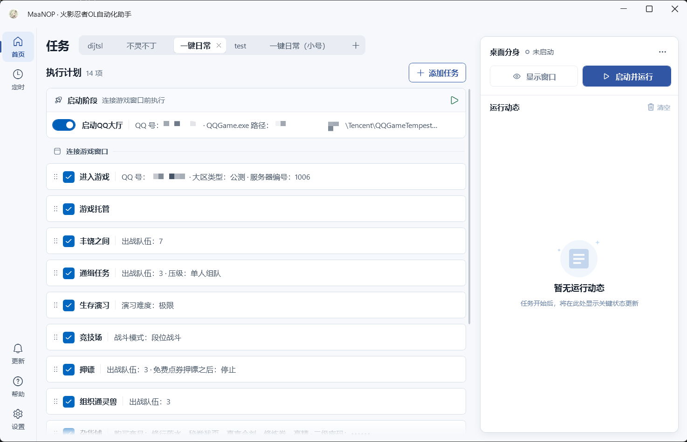

<!-- markdownlint-disable MD033 MD041 -->

  

# Bunshin

[MaaNOP](https://github.com/ArcherSore/MaaNOP) 的 Windows 桌面界面：让火影忍者 Online 的日常任务在后台自己跑

  

## 它能做什么

Bunshin 通过 Windows 的 Child Session（桌面分身）在独立会话中运行游戏和自动化任务，**不占用你正在使用的桌面**，
你可以一边工作一边让任务在后台执行。

- **桌面分身**：游戏运行在独立桌面中，隐藏分身窗口后任务仍会继续。
- **多份任务配置**：每份配置单独保存任务、勾选状态和参数，可从项目预设一键新建。
- **定时执行**：按每周时间表自动运行，随时可以看到下次运行的时间。
- **运行监控**：查看任务动态，通过小窗观看分身，需要时可手动接管操作。
- **自动运行**：支持开机自启，也可用命令行接入计划任务或外部脚本。

## 安装

**系统要求**：Windows 10 / 11（64 位）。

1. 前往 [MaaNOP](https://github.com/ArcherSore/MaaNOP) 下载完整包并解压。本仓库只提供界面，游戏任务资源在完整包里。
2. 运行包内的 `DependencySetup_依赖库安装.bat`，安装 .NET 10 桌面运行库和 Visual C++ 运行库（只需一次）。
3. 运行 `Bunshin.exe`，按提示允许管理员权限。
4. 首次使用需要保存 Windows 凭据，并按需配置 QQ 游戏大厅自动启动，步骤见[用户使用手册](docs/USER-GUIDE.md)。

之后的更新可在程序内完成。

## 文档

- [用户使用手册](docs/USER-GUIDE.md)：首次配置、命令行启动、定时执行、常见问题。

## 遇到问题

先看[用户使用手册](docs/USER-GUIDE.md#常见问题)里的常见问题。没有解决时，欢迎到
[Issues](https://github.com/ArcherSore/NarutoAutoGUI/issues) 反馈，并附上系统版本、Bunshin 版本和出错时的现象。

## 参与开发

构建、自检和发布流程见 [CONTRIBUTING.md](CONTRIBUTING.md)。

## 鸣谢

- [MaaNOP](https://github.com/ArcherSore/MaaNOP)：游戏自动化任务与资源。
- [MaaFramework](https://github.com/MaaXYZ/MaaFramework)：自动化执行框架。
- [BetterGI](https://github.com/babalae/better-genshin-impact)：桌面分身方案参考了其 v0.63.0 引入的 Windows Child Session 实现。

## 许可证

[GPL-3.0](./LICENSE)。第三方组件见 [THIRD_PARTY_NOTICES.md](THIRD_PARTY_NOTICES.md)。
