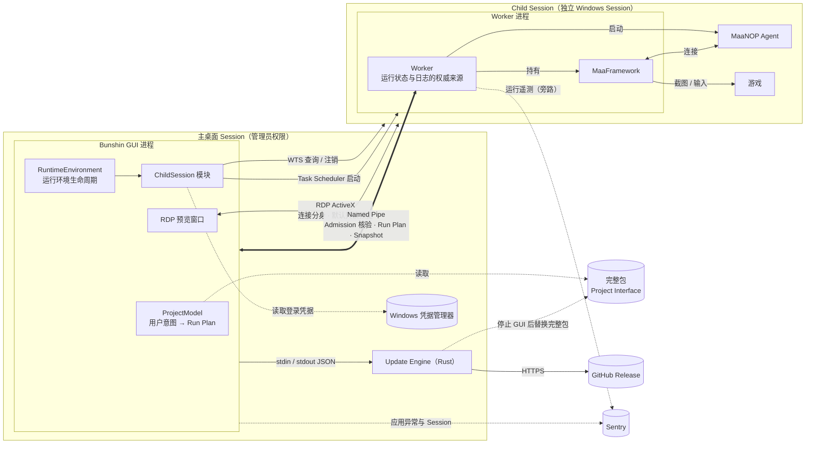

# 当前架构

Bunshin 是面向 MaaNOP 的 Windows x64 前端。主桌面负责配置与观察；游戏、自动化框架和 Worker 在 Child Session 中运行。发布包包含 GUI、Worker、固定 MaaFramework runtime、Update Engine 和依赖安装脚本；MaaNOP 项目内容由完整包提供。.NET 10 桌面运行库和 Visual C++ 运行库由系统提供。

## 系统总览

## 组件与边界

| 组件 | 职责 |
| --- | --- |
| Bunshin（.NET 10 WPF） | 用户界面、托盘、设置、任务配置、Child Session 生命周期、Worker 接纳和运行观察 |
| ChildSession 模块 | 通过 Windows WTS、RDP ActiveX 和 Task Scheduler 管理隔离会话与程序启动 |
| ProjectModel | 读取 MaaNOP Project Interface，保存用户意图，解析本次 Run Plan |
| Protocol | GUI 与 Worker 共享的消息与运行模型 |
| Worker | 在 Child Session 中持有 MaaFramework、MaaNOP Agent、运行状态和日志 |
| UpdateEngine（Rust） | 完整包更新的检查、准备、校验、安装和重启规则 |

GUI 不加载 MaaFramework 执行任务。Worker 不读取或修改用户任务配置，也不重新解释 Project Interface 的选项。MFAAvalonia 仅用于人工对照，不参与正式运行链路。

Worker 就绪检查只覆盖自身 MaaFramework、资源目录和 Agent 可执行程序，不探测项目实现语言或解释 Agent 参数。
MaaNOP 自行打包和初始化语言运行时及共享库路径；Worker 按声明启动 Agent，通过实际连接和退出结果判断启动是否成功。
MaaNOP 向 Bunshin 对齐：Bunshin 先发布并决定共享版本（如 Worker 携带的 MaaFramework），MaaNOP 打包时从中取用，两者之间不做对等的版本检查。

## 运行环境生命周期

GUI 启动时检查已有 Child Session，必要时恢复 RDP 预览宿主。创建或恢复后，程序在独立 Windows Session 中运行。隐藏桌面分身只隐藏宿主窗口，保留 RDP 连接及其中程序。

用户可在设置中保存用于 Child Session 登录的 Windows 账户密码。凭据只存于 Windows 凭据管理器，建立 RDP 连接时读取并提交给 ActiveX；设置页也会读取凭据以显示保存状态和账户。账户和密码不进入配置、日志或诊断包；登录是否成功以 RDP 登录完成为准。未保存或无法读取时保持 Windows 原有的密码提示。

凭据读写仅在 Windows 返回 1312 时，以同用户、同会话且未提权的资源管理器令牌在当前进程内重试一次。
身份模拟仅覆盖固定分身凭据的访问，结束或异常时恢复原身份；RDP、分身生命周期与 Worker 启动仍使用原权限。

RuntimeEnvironment 持有运行环境闸门，负责准备与结束运行环境。准备时创建或恢复 Child Session、连接 RDP 并接纳 Worker。游戏可在分身中手动启动，也可由开始任务时的 Project Interface pretask 启动。GUI 的准备、开始、停止、换场、收尾、退出与安装更新共用这把闸门。用户确认后才排队，取得闸门后按当前状态复核。[ADR 0018](adr/0018-runtime-environment-gate.md)

托盘、主窗口、定时收尾、退出与安装更新共用以下结束顺序。

1. 捕获已跟踪 Worker 的进程身份，向可停止的 Active Run 发送 `run.stop`，最多等 30 秒。停止失败或超时会记录日志并继续注销。
2. 对捕获的 Child Session ID 发起非阻塞注销，轮询 Windows 会话列表，最多等 60 秒确认该 ID 消失。定时收尾还要核验成功 Run、Worker 和分身的归属。
3. 确认分身已结束后，最多等 30 秒确认已跟踪的 Worker 进程退出。进程退出后的管道读完期限为 5 秒，随后发布退出证据、摘除 Admission。没有已跟踪 PID 时使用已确认的分身注销作为结束证据。

无法确认分身或 Worker 已结束时，GUI 报告“结束未确认”，保留 Admission 并释放闸门，用户可以再次结束。退出和安装更新在此处取消，GUI 保持打开。

GUI 以真实 Windows 进程和 Session 身份核验 Worker，再通过受限的本机 Named Pipe 接纳连接。同一 Child Session 只接纳一个 Worker。GUI 只在能证明 Worker 已不存在或 Child Session 已确认注销时丢弃 Admission，无法确认时拒绝准备；每次启动 Worker 前还会确认目标 Child Session 中没有 Worker 进程。断线时，已接纳 Worker 可继续运行；GUI 重连后取得新的完整 Snapshot 才能重新作出执行决策。Worker 不具备跨进程退出恢复 Run 的能力。

确认 Worker 进程退出后，进程监视和环境结束流程共用原连接的等待期限。读循环先把缓冲帧提交给 RunLifecycle，读到 EOF 后发布进程退出证据，环境结束流程随后摘除 Admission。等待满 5 秒仍无 EOF 时强制关闭连接。已接纳的 Run 有匹配终态就按终态交付提醒及绑定的 `-q`，缺少终态则结算为运行结果未确认。

这些路径依赖管理员权限、交互式 Windows 桌面、RDP ActiveX、WTS、Task Scheduler COM 和 WMI。Child Session 的显示分辨率和缩放固定为 1920×1080、100%；预览缩放不改变隔离桌面的实际设置。

## 启动与自动执行

程序的 manifest 不要求管理员权限：启动时先处理 `--help`，再检查是否已提权，未提权则带着原参数通过 `runas` 重启自己并退出；
这一步在单实例锁、日志和窗口之前。无人值守的计划任务以最高权限启动，已提权，不会再弹 UAC。

一次启动由命令行决定性质：带 `--autostart` 的是系统（登录计划任务）发起的无人值守启动，主窗口留在托盘、不弹公告和新手指引，任何 Windows Session 里已有同一程序在运行时都静默退出（登录任务也会在本程序创建的 Child Session 里触发）。
自动执行不是新的执行路径：LaunchCommand 与应用偏好交给 AutoRunPlanner 决定是否执行、执行哪份配置，随后激活该配置并走与“准备并开始”相同的流程。
该流程中开始前的失败写日志并以托盘通知。
`-q`（`--quit-after-run`）只属于本次启动的自动执行意图。开始写入 `run.start` 正文时，状态机把退出资格绑定到该 Worker 实例与 Run ID。收到匹配的成功、失败或取消终态后才请求退出，该 Run 如有提醒则先呈现。结算为未能启动、启动结果未知或运行结果未确认时清除绑定。手动重试即使复用原 Run ID，也只取得自己的提交身份。

全局偏好 `schedule.forceStart` 默认关闭，到点遇到 Active Run 时跳过。开启后，首份获准的定时配置
遇到未被 `-q` 跟踪的 Active Run 时发出提示和可取消的 10 秒倒计时。倒计时使用调度时钟，期间不占用运行环境闸门。
取消会消耗本次机会。到期后等待闸门，按最新状态决定是否换场。退出、安装更新或已确认的手动结束请求优先。手动结束分身后新到点的强制定时照常准备新分身。
旧分身还在、Worker 状态未确认且无法判断是否需要倒计时时，跳过本次定时机会。
命令行 `-q` 任务已绑定退出资格或正在等待退出时，各类定时都跳过本次机会，运行动态记录“命令行任务尚未结束”。强制定时在决定倒计时前和拿到闸门、开始换场前读取最新的运行编排状态。若该任务的 Worker 一直处于 Faulted，后续定时也会跳过，直到用户结束桌面分身。
手动停止等待闸门，取得后用新鲜快照核对用户点击时的 Worker 和 Run，只对仍可停止的原任务发送 `run.stop`。手动停止或手动结束桌面分身后，Worker 确认的 Cancelled 终态照常触发 `-q` 退出。

## 启动确认与结算

手动开始和重试、开机自动执行、定时执行都由 `RunLifecycleHost` 登记提交。一次意图有独立的意图 ID，一次执行由 `RunKey(WorkerInstanceId, RunId)` 标识，每次发送都有自己的 `SubmissionId`。同一 Worker 重连后仍可确认原 Run，迟到应答按原发送归属。

`WorkerCoordinator` 核验 Worker 身份，按连接代次和写入顺序提供正文边界、应答、有序查询、快照及进程退出证据。RunLifecycle 纯状态机（`RunLifecycleReducer`）据此确认启动、决定何时补查，并向运行通知、定时完成与收尾、`-q` 三个消费者交付结果。确认期间只查询原 Run。调度候选和倒计时由窗口编排，环境互斥、准备及实际清理归 `RuntimeEnvironment`。同一次运行的接纳、发起者和交付进度只由 RunLifecycle 判定，其他对象不另行记录；分散在多个对象里判定时，每轮修复都会引出新的回归（[#122](https://github.com/ArcherSore/Bunshin/issues/122)）。

宿主在 Dispatcher 上串行提交状态转换。手动操作、待交付的结论、定时完成与收尾占位、命令行 `-q` 任务的跟踪状态均同步反映在 `RunLifecycleHost.Orchestration`。取得环境闸门的入口先处理已到达的证据，再按这份状态决定是否启动或清理。错误框和托盘气泡按 RunKey 异步呈现，一个 Run 的模态框可以保持打开，其他 Run 仍可完成和收尾。

## 任务与状态流

Configuration Set 保存多份独立任务配置及激活项；它是用户意图，不是执行结果。ProjectModel 按当前 Project Interface 校验激活配置，开始时生成不可变、有序的 Run Plan。Worker Launch Context 独立确定项目与框架环境；Run Plan 只描述本次任务与参数。

每周定时策略归属于任务配置 ID。GUI 在进程内按本地当前分钟检查策略，把已处理的配置 ID 和分钟保存在运行状态目录，供同分钟重开时去重。
同刻命中时按配置列表顺序校验，首份获准的配置与手动、开机启动共用运行环境操作闸门。普通定时先提交编辑，需切换配置时先保存激活项。保存失败就保留旧环境。换场时先确认旧分身及其 Worker 已退出，再准备新分身。
只有新鲜 Worker Snapshot 确认本次定时 Run 成功，GUI 才自动结束该分身。失败或手动停止后保留现场。

Project Interface preset 作为新建配置的模板：ProjectModel 将预设的任务选择和选项值转换为现有 Task Configuration，
保存后不再关联预设。新配置只在项目默认值上应用预设声明的内容，不继承当前配置；普通任务沿用预设列出的顺序，之后可由用户调整。
配置继续按选项名称共享显式值，预设中的冲突值会拒绝创建，不静默覆盖。

每份 Task Configuration 保存已添加的任务、各项勾选状态和显式参数。普通任务与 pretask 共用配置操作，开始时只校验本次勾选且适用的任务及其参数。ProjectModel 按项目声明顺序把选中的 pretask 放在普通任务之前；pretask 的选项只生成程序参数，不合并到 Pipeline Override。Worker 在 Child Session 中执行程序，工作目录为项目根目录；成功后才为普通任务创建 MaaFramework Controller。仅勾选 pretask 时也可开始。仅含 pretask 的 Run 不创建 Controller，成功启动的游戏进程保留。

Worker 同时只执行一个 Run，逐项处理 Plan Item。pretask 非零退出、启动失败或超时均终止后续项；每项外层超时为 180 秒。停止或超时后，Worker 最多等待 30 秒确认程序及其受控后代已结束；无法确认时进入 Faulted 并保留 Active Run，不报告执行终态。停止请求先进入 Stopping，最终结果由 Worker、程序退出状态和 MaaFramework 的执行结果决定。Worker 是 Worker State、Run State 和 Plan Item 状态的权威来源。GUI 把连接、进程与 Session 状况作为独立的 GUI Observation；断线不伪造 Run 失败。

停止未确认或 Run 后台循环出现意外异常时，Worker 进入 Faulted，Active Run 保持原状态、不终结。此时执行终止未确认；Worker 失联且进程未被证明已退出，或上次结束运行环境未确认，也是如此。执行终止未确认期间，GUI 不提供重试、开始或准备，只提供结束桌面分身作为恢复方式。恢复条件按原因不同：单纯失联时，重连并取得新鲜快照后按快照恢复相应控制，确认进程退出则按已退出处理；重连后的新鲜快照仍是 Faulted 时，仍只能结束桌面分身；上次结束未确认时，即使 Worker 已退出，也要再次结束并确认成功。

控制和状态通过 Named Pipe 传递；完整 Snapshot 用于初次同步和重连，事件用于加快显示，日志另按 sequence 补取。稳定的传输契约见 [Worker IPC](WORKER-IPC.md)。

## 桌面分身观看

观看复用已有 RDP 控件及独立窗口，不经 Worker 额外采集或共享像素帧。小窗默认置顶只读，大窗仍只读，用户手动解锁后才可操作。隐藏、重新打开及返回小窗恢复只读；窗口变化不重建连接、不停止任务。登录凭据输入阶段保留交互，登录完成立即锁定。任务识别所需截图仍由 MaaFramework 执行。

## 更新

GUI 负责更新界面、用户确认和运行环境关闭；Rust Update Engine 负责 Release 选择、完整包下载与验证、缓存和安装。GUI 将 Engine 给出的 descriptor/reference 原样交回，不解释更新包。安装前必须停止任务并确认运行环境退出；Engine 接管安装后等待 GUI 进程退出，再替换完整包内容。更新契约见 [Update Engine 文档](UPDATE-ENGINE.md)。

## 遥测

MaaNOP 在 Project Interface 声明 telemetry.sentry 时，Bunshin 向该 Sentry 项目匿名上报，设计取舍见
[ADR 0009](adr/0009-worker-owns-run-telemetry.md)。GUI 持有"帮助改进软件"开关和发布闸门：默认只有发布版 GUI 与发布版项目、
且不在自检中才启用遥测（手动验证时 `BUNSHIN_TELEMETRY_FORCE=1` 可放行开发版本，自检禁用和用户开关仍生效），再把配置和用户选择交给 Worker。GUI 自身只上报未处理异常和应用 Session；Worker 观察自身的运行状态，上报 Run 与 Plan Item 的结果；
Plan Item 失败时在后台取该项时间窗内的 maafw.log、Worker 日志和按采样的错误截图，Run 不等待。
遥测始终是旁路：初始化、发送或记录失败只写日志，不改变 Run、Worker 状态或运行环境生命周期，也不延迟结束运行环境。
上报不含机器名等可识别信息；本次 Run 用到的 PI password 输入值在上报前脱敏。传输契约见 [Worker IPC](WORKER-IPC.md)。

## 当前支持边界

支持按顺序执行不重复的顶层 MaaNOP task、Project Interface pretask、多份独立配置、桌面分身只读观看与手动操作和完整包更新。当前不支持同一 task 的多实例独立参数、依赖图、条件或并行调度，也不内置 QQ 登录或游戏登录资源、托管启动入口、录制或可调 Child Session 分辨率/DPI。

模块内部结构见 [Worker](WORKER.md) 与 [Child Session](CHILD-SESSION.md)；设计取舍见 [ADR](adr/)；领域术语见 [GLOSSARY](../GLOSSARY.md)。
