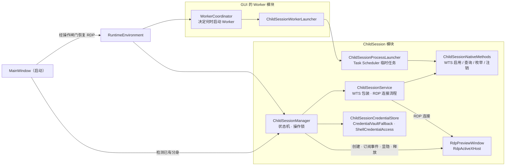
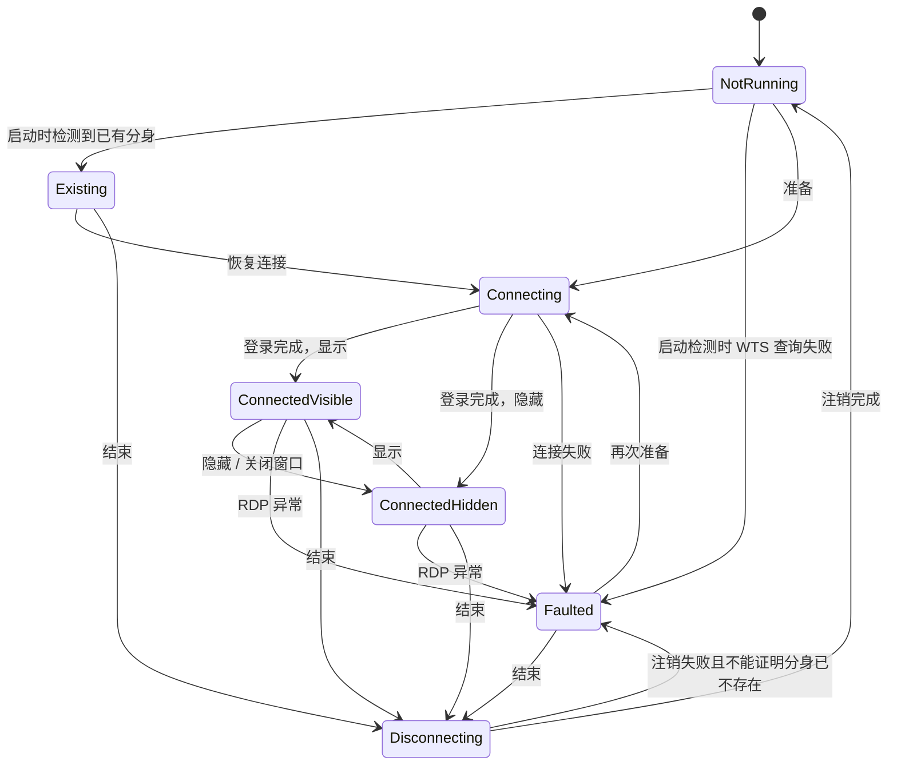

# Child Session 模块

src/Gui/ChildSession/ 负责创建、观看和结束桌面分身，以及向其中启动进程。产品行为和凭据规则见 [ARCHITECTURE](ARCHITECTURE.md)，取舍见 [ADR 0008](adr/0008-reuse-rdp-for-viewing.md)。运行环境何时准备、何时结束由 RuntimeEnvironment 决定，本模块只提供能力。

## 子区域与调用方

Manager 不启动 Worker。RuntimeEnvironment 经 WorkerCoordinator 决定启动 Worker，GUI 的 Worker 模块中的 `ChildSessionWorkerLauncher` 再调用 `ChildSessionProcessLauncher` 注册 Task Scheduler 临时任务。Manager 只负责会话、RDP 连接和预览窗口。GUI 启动时 MainWindow 直接调用 Manager 检测已有分身，检测到后经 RuntimeEnvironment 的操作闸门只恢复 RDP 连接，不准备 Worker。

## 状态

Manager 的“建立/恢复”和“结束”共用一把操作锁，不会交叉执行。对已连接的分身再次准备时直接复用，不重建连接。

## 容易判断错的地方

1. **创建分身靠 RDP 连接，不靠 WTS。** WTS 只用于启用 Child Session 支持、查询、枚举和注销。
2. **“分身是否存在”必须用 `QueryChildSessionId`。** Session 枚举成功时，它把 WTS 报告的 ID 与枚举结果取交集，因为 RDP 登录失败后 WTS 可能仍报告一个已消失的 ID。枚举失败时，默认查询保留 WTS 报告的 ID；定时调度和成功后自动结束使用严格查询（`requireEnumeration: true`），枚举失败即抛出并中止本次判断。注销失败也只在能证明分身不存在时才当作已结束。
3. **隐藏窗口与移出屏幕是两条路径。** 日常隐藏先锁定输入，再调用 WPF `Hide()`；关闭窗口被转换成隐藏，RDP 连接始终保持。只有后台建立连接且已保存凭据时才用 `ShowOffscreen()`，因为 ActiveX 必须在已显示的原生窗口中初始化；Windows 需要用户操作时窗口回到屏幕上。没有保存凭据时窗口在登录阶段可见，登录完成后仍按 `showPreview` 决定显隐。
4. **线程有约束。** ActiveX 只能在 UI 线程访问；WTS 注销要等待完成，放在 `Task.Run` 中，同时一直持有操作锁。
5. **launcher 在临时任务观察到新进程之后才删除它**，并在启动前核对目标 Session 没有变化。过早删除会丢掉刚创建的 Session 尚未执行的启动。但只要任务已注册，超时、取消或失败时也会在 `finally` 中删除，排查启动超时时不要指望任务还留在计划程序里。
6. **凭据在连接前一刻读取**，不缓存；只有固定的分身凭据允许借用资源管理器令牌，且仅在读写返回 1312 时重试一次。

## 改动指引

- 模块外需要知道分身是否存在或其 ID：用 `ChildSessionManager.QueryChildSessionId`，不要直接调 WTS。
- 需要在分身中启动程序：用 `ChildSessionProcessLauncher`，不要另写 Task Scheduler 调用。
- 需要新的观看行为：加在 `RdpPreviewWindow` 与 Manager 的显示状态里，不要另建窗口或第二条 RDP 连接。
- 分身的状态变化统一经 Manager 的 `UpdateState` 发出，不要在别处自行维护一份。
