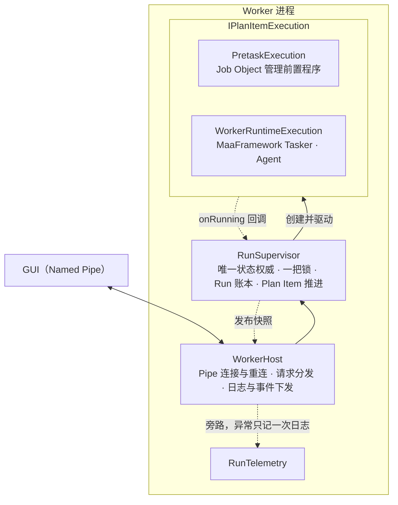
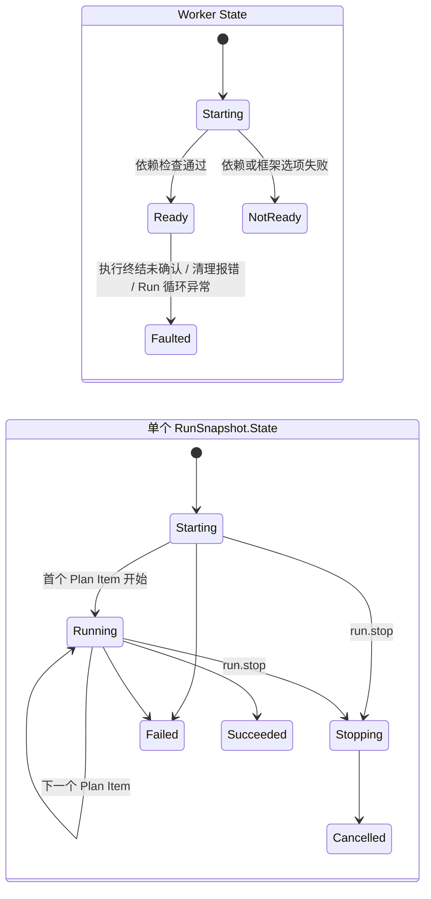

# Worker 内部结构

Worker 在 Child Session 中运行，是 Worker State、Run State 和 Plan Item 状态的唯一权威。传输契约见 [Worker IPC](WORKER-IPC.md)，取舍见 [ADR 0001](adr/0001-child-session-worker-owns-runs.md)。

## 分层

WorkerHost 不持有任何 Run 状态；RunSupervisor 不知道 Pipe；执行类不改状态，只返回结果，并在前置程序启动成功或 Maa 任务开始运行时经 `onRunning` 通知 RunSupervisor，由它加锁提交 Running。

## 状态

- Run 终结时，同一次提交清空 `ActiveRun`、把终态写入 `LastRun`，顶层 `WorkerSnapshot.RunState` 随即为 Idle。GUI 判断某个 Run 的结果要匹配 `LastRun.RunId` 和 `LastRun.State`，不能等顶层 RunState。
- Plan Item：首项在 Run 接受时直接为 Starting，其余为 Pending；之后 Starting → Running → Succeeded / Failed / Cancelled，程序启动失败可从 Starting 直接 Failed；停止先于 `onRunning` 到达时，迟到的回调被忽略，当前项从 Starting 直接 Cancelled。前一项失败或收到停止时，后续 Pending 项直接成为 Cancelled。
- 收到停止后，无论执行结果如何，Run 的终态都是 Cancelled；停止未确认时 Run 停在 Stopping，保留为 Active Run。
- Worker 进入 Faulted 后在本进程内不会恢复。两类情况要区分：
  - **无法确认执行已终结**：执行器返回 `StopTimedOut`，或 Run 循环异常。`StopTimedOut` 既可能是停止未确认，也可能是用户没点停止、Maa 原生任务收尾未确认（`NativeTaskCompletionUnconfirmed`）。此时 Active Run 保持原状、不终结，Run 可能仍是 Running。
  - **清理报错但已终结**（`CleanupFailed`）：同一次状态提交中，LastRun 记录终态，Worker 进入 Faulted。

  恢复方式都是 GUI 结束桌面分身。
- NotReady 同样只在启动时产生，不会回到 Ready。

## 不变量

这些规则分散在代码里，改动前先确认没有破坏：

1. **状态只在 RunSupervisor 的锁内修改**，每次提交 stateRevision 加一。执行和停止在锁外进行，因为 `onRunning` 回调要重新取锁；锁内不放回调、日志和等待。
2. **停止有固定次序**：置停止标志 → 回复 run.stop → 写出完整 Stopping 快照 → 才开始实际停止执行。打乱次序会让 GUI 看不到“已受理”。ACK 写出后，即使 Stopping 快照写失败（如断线），`BeginStopAsync` 也在 `finally` 中开始停止，RunSelfTests 有对应自检；不要让停止依赖快照送达。
3. **pretask 成功交接与 Stop 竞争**：成功提交与交接下一项共用状态锁；Stop 先到时走 `CancelPendingSuccessAsync`，先回复停止再清理子进程。
4. **pretask 成功后保留其启动的程序**：Job Object 在成功提交时撤销 kill-on-close，否则游戏会随 Worker 退出。失败、停止或超时则终止整个 Job。
5. **Run 幂等由 runId 加 planDigest 的账本保证**：同 runId 不同 digest 是冲突，同 digest 重试返回已接受。
6. **遥测不影响 Run**：只经 `Telemetry(...)` 包装调用，异常被吞掉，不进入状态机。

## 与其他“Faulted”的区别

代码里有三个 Faulted，含义不同：

| 名称 | 所有者 | 含义 | GUI 提供的操作 |
| --- | --- | --- | --- |
| `WorkerState.Faulted` | Worker | 无法确认执行已终结（停止或原生任务收尾未确认）、Run 循环异常（Active Run 保留），或清理报错（Run 已有终态） | 只提供结束桌面分身；按有无 Active Run 分别说明为停止未确认或运行环境故障 |
| `ChildSessionState.Faulted` | GUI 的 ChildSession 模块 | 启动时会话探测失败、RDP 连接或注销失败 | 单独出现且 GUI 空闲时，提供重试准备 |
| 执行终止未确认 | GUI 的综合判断 | Worker Faulted、Worker 失联或接纳冲突，或上次结束运行环境未确认 | 只提供结束桌面分身，见 `RuntimeControls` |

## 改动指引

- 新增一种 Plan Item 需要同时改：Protocol 的 `PlanItemKind` 与载荷、ProjectModel 的 Run Plan 生成、`RunSupervisor.ValidateRunPlan` 的载荷与顺序校验（未登记的种类会以 `invalid_run_plan` 拒绝）、实现 `IPlanItemExecution` 并在 `WorkerHost.CreateRuntimeExecution` 登记。涉及子进程所有权交接时，还要审查 `AdvanceRunAsync` 对 `PretaskExecution` 的专门分支。
- 新增需要 GUI 观察的状态：加入快照，经 `RunSupervisor` 提交；不要在 WorkerHost 或执行类里另存一份。
- 新增 IPC 操作：在 `HandleRequest` 分发，并先更新 [Worker IPC](WORKER-IPC.md) 与协议版本。
